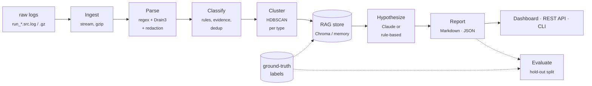
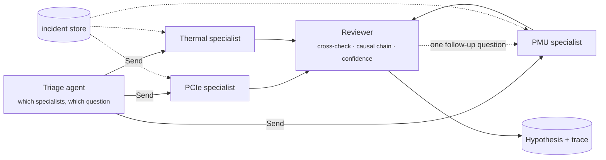

<div align="center">

# 🔬 SVLA-Agent

**Silicon Validation Log Analysis Agent** — an agentic AI debug assistant for post-silicon validation logs.

[](https://github.com/SapnilPatel/Silicon-Validation-Log-Analysis-Agent/actions/workflows/ci.yml)
[](https://sapnilpatel.github.io/Silicon-Validation-Log-Analysis-Agent/)
[](https://svla-agent.streamlit.app/)
[](#quickstart)
[](#enabling-claude)
[](LICENSE)
[](https://github.com/astral-sh/ruff)

### 🌐 [**Project site & report explorer**](https://sapnilpatel.github.io/Silicon-Validation-Log-Analysis-Agent/) &nbsp;·&nbsp; 🚀 [**Live analysis app**](https://svla-agent.streamlit.app/)

The project site explains the pipeline, shows the measured results and lets you explore real reports.<br>
The live app analyses runs on demand and accepts your own logs; paste an Anthropic key in its sidebar to switch the agent to Claude — nothing is stored.

</div>

---

SVLA-Agent ingests large multi-source silicon test logs, parses them into structured
events, classifies and de-duplicates failures, clusters recurring failure families,
retrieves similar historical incidents (RAG), and names a **specific, evidence-backed
root cause** with remediation steps — delivered as Markdown/JSON debug reports, a REST
API and an interactive dashboard.

> The whole pipeline runs **offline** out of the box (deterministic fallbacks for
> embeddings, retrieval and hypotheses). Add an `ANTHROPIC_API_KEY` to upgrade the
> hypothesis agent to Claude.

## ✨ Highlights

- **Root cause, not just failure type** — a catalogue of 20 named root causes across 6 failure types; the agent scores them against the evidence and cites the tell-tale lines.
- **A team of agents, when you want one** — multi-agent mode runs a LangGraph team per failure: a triage agent dispatches subsystem specialists in parallel, each confined to its own subsystem's logs and catalogue; a reviewer cross-checks their findings into a causal chain. Single-agent tool-loop and one-call modes are also there. Every agent step is kept as a trace. [Details ↓](#-agent-modes)
- **Measured** — on a 400-run hold-out corpus: detection / typing F1 **1.00**, retrieval recall@5 **1.00**, root-cause top-1 **0.96** (rules) / **0.94** (Claude). [Details ↓](#-evaluation)
- **Calibrated confidence** — when Claude is wrong its confidence drops to **0.47** (rules: 0.77), so the number is usable for triage.
- **Fast & streaming** — 1.45 M log events (97 MB, 700 files) parsed, template-mined and classified in **23 s** on a laptop, ~64 k events/s, flat memory.
- **Privacy first** — e-mails, IPs, MACs, serials and credentials are redacted *before* indexing, prompting or reporting.
- **Pluggable** — vector store (`chroma` / `memory`) and LLM provider behind small interfaces; Claude + Chroma ship.
- **Three front doors** — `svla` CLI, FastAPI REST service, Streamlit dashboard. Docker image built in CI.
- **Offline, deterministic tests** — 61 tests incl. the REST API, the headless dashboard and scripted agent/team runs; CI on Python 3.10–3.12.

## 📚 Contents

- [How it works](#-how-it-works)
- [Quickstart](#-quickstart)
- [CLI & REST API](#-cli--rest-api)
- [Enabling Claude](#-enabling-claude)
- [Agent modes](#-agent-modes)
- [Evaluation](#-evaluation)
- [Example report](#-example-report)
- [Dataset](#-dataset)
- [Development](#-development)
- [Docs](#-docs)

## 🧭 How it works



| Stage | Module | What happens |
|---|---|---|
| **Ingest** | `ingest/reader.py` | Discover & group per-source run files (`run_*.<src>.log[.gz]`), stream lines lazily |
| **Parse** | `parse/parser.py` | Regex line structure (ts / subsys / level / `k=v` / multi-line dumps) + Drain3 template mining |
| **Redact** | `privacy/redact.py` | Scrub e-mails, IPs, MACs, serials, credentials *before* anything is indexed or prompted |
| **Classify** | `classify/classifier.py` | Error/fatal events → prioritised `Failure` records with cross-subsystem evidence; fingerprint dedup |
| **Embed** | `embeddings/embedder.py` | sentence-transformers embeddings (deterministic hashing fallback offline) |
| **Cluster** | `cluster/clusterer.py` | HDBSCAN within each failure type → explainable failure families |
| **RAG** | `rag/` | Pluggable vector store (`chroma` persistent, `memory` numpy) over historical failures |
| **Hypothesize** | `hypothesize/` | Root-cause catalogue + evidence scoring; Claude in one call, as a tool-using agent, or as a LangGraph team of specialists |
| **Report** | `report/reporter.py` | Jinja2 Markdown + JSON debug reports |
| **Serve** | `api.py`, `app/streamlit_app.py` | FastAPI REST service and Streamlit dashboard |
| **Evaluate** | `eval/metrics.py` | Detection, typing, clustering, hold-out retrieval and root-cause accuracy |

## ⚡ Quickstart

```bash
git clone https://github.com/SapnilPatel/Silicon-Validation-Log-Analysis-Agent.git
cd Silicon-Validation-Log-Analysis-Agent
python -m venv .venv && source .venv/bin/activate
pip install -e ".[dev,app,api]"

# Try it on the bundled 24-run sample dataset (no generation needed)
svla process --logs examples/sample_logs --labels examples/sample_labels
streamlit run app/streamlit_app.py

# Or the full flow: 100 synthetic runs -> reports -> metrics -> dashboard / API
svla generate --runs 100
svla process
svla eval --out reports/metrics.json
svla serve            # REST API on http://localhost:8000/docs
```

A `Makefile` wraps the common flows (`make dev-install data process eval app serve check`),
and `make docker-build && make docker-api` runs it in a container. See
[docs/DEPLOYMENT.md](docs/DEPLOYMENT.md) for Streamlit Cloud, Docker and Hugging Face.

## 🛠 CLI & REST API

```
svla generate   Generate the synthetic silicon-log dataset
svla process    Run the full analysis pipeline and write debug reports
svla index      (Re)build the RAG vector store of historical failures
svla eval       Evaluate against ground truth (hold-out retrieval + root cause)
svla import-bgl Convert the real Loghub BGL log into runs for out-of-distribution eval
svla serve      Serve the REST API (FastAPI + uvicorn)
svla version    Print the version
```

Useful flags:

```bash
svla process --limit 20              # only the first N runs
svla process --run 000007            # a single run (uses the existing RAG store)
svla process --no-index              # skip rebuilding the vector store
svla eval --holdout 0.3 --out reports/metrics.json
svla serve --port 8000
```

| Endpoint | Purpose |
|---|---|
| `GET /health` | Active backends (embeddings, store, agent) and index size |
| `GET /runs`, `GET /reports`, `GET /reports/{run_id}` | Browse runs and reports |
| `POST /analyze/{run_id}` | Analyse a run from the logs directory |
| `POST /analyze/upload` | Analyse uploaded `run_<id>.<source>.log[.gz]` files |
| `POST /index` · `GET /metrics` · `GET /clusters` · `GET /knowledge` | Index rebuild, eval metrics, families, root-cause catalogue |

Send `X-Anthropic-Key: <your key>` to have that one request use Claude. Interactive docs at `/docs`.

## 🤖 Enabling Claude

By default the root-cause agent uses a deterministic, rule-based fallback so the
pipeline is fully runnable offline. To use Claude:

```bash
cp .env.example .env
# then set ANTHROPIC_API_KEY in .env (and optionally SVLA_LLM_MODEL / SVLA_LLM_EFFORT)
```

Both paths see the same evidence, the same root-cause candidates and the same
retrieved incidents, and return the same `Hypothesis` shape (including a
`root_cause_id` that evaluation can score). Configuration is read by
`pydantic-settings` (prefix `SVLA_`); the main knobs:

| Setting | Default | Purpose |
|---|---|---|
| `ANTHROPIC_API_KEY` | _unset_ | Enables Claude; unset ⇒ rule-based hypotheses |
| `SVLA_LLM_MODEL` | `claude-opus-5-5` | Hypothesis model (`SVLA_LLM_EFFORT` sets thinking depth, default `medium`) |
| `SVLA_EMBEDDING_MODEL` | `all-MiniLM-L6-v2` | sentence-transformers model |
| `SVLA_VECTOR_BACKEND` | `chroma` | `chroma` (persistent) or `memory` (numpy, file-backed) |
| `SVLA_REDACT` | `1` | PII / secret redaction at parse time |
| `SVLA_OFFLINE` | `0` | Force network-free, deterministic paths (used by CI) |
| `SVLA_CHROMA_DIR` / `SVLA_REPORTS_DIR` | `.chroma` / `reports` | Store and report locations |

Full list in [.env.example](.env.example).

## 🕵️ Agent modes

Three ways to let Claude name the root cause, selected with `SVLA_LLM_MODE` or a CLI flag:

| Mode | What happens | Calls / failure |
|---|---|:---:|
| `direct` (default) | One strict tool call with the evidence, candidates and retrieved incidents | 1 |
| `agentic` (`--agentic`) | One agent with tools investigates in a bounded loop, then answers | 4–6 |
| `multiagent` (`--multi-agent`) | A LangGraph team: triage → parallel subsystem specialists → reviewer | 10–25 |

### Multi-agent team (LangGraph)



- **Triage** reads the failure and the subsystems that logged around it, picks up to four
  specialists and gives each a specific question (power and thermal are frequent upstream causes).
- **Specialists** run in parallel. Each has its own system prompt, its own slice of the
  root-cause catalogue, and `get_context` scoped to *its* subsystem's lines, so the PMU
  specialist reports a voltage droop the DDR specialist never sees. They report a
  structured finding, not a verdict.
- **Reviewer** cross-checks the findings against each other and the error lines, may send
  exactly one specialist back with a pointed question, then submits the hypothesis with a
  causal chain ("PMU droop → DDR corrected errors → UE") and a confidence that reflects
  how well the findings agree.

The graph is a plain LangGraph `StateGraph` with a `Send` fan-out (`hypothesize/multiagent.py`);
the model calls go through the same Anthropic provider as the other modes. Every message
is recorded on the hypothesis trace with the agent's name and rendered in the report, the
dashboard ("Team investigation") and the project site's explorer.

### Single agent with tools (`agentic`)

In **agentic mode** one agent gets tools and decides what to look at:

| Tool | What it returns |
|---|---|
| `get_context(start_ms, end_ms, include_info, subsystem)` | Log lines from any subsystem in a time window, telemetry optional |
| `read_block(ts_ms)` | The full register dump / stack trace attached to the nearest error |
| `search_incidents(query, top_k)` | Similar resolved failures from the vector store, with their root causes |
| `lookup_catalogue()` | Known root causes for the failure type with their tell-tale markers and playbook |
| `submit_hypothesis(...)` | The answer: root-cause id, statement, calibrated confidence, rationale, actions |

```bash
svla process --run 000005 --agentic          # or SVLA_LLM_MODE=agentic
svla eval --llm --agentic --out reports/metrics_agentic.json
```

The loop is bounded (`SVLA_AGENT_MAX_TURNS`, default 8), uses `tool_choice: auto`
with strict schemas, returns all of a turn's tool results in one message, and
falls back to the rule-based agent on refusal or failure. Every call is recorded
on the hypothesis as a trace and shown in the Markdown report, the dashboard's
"Agent investigation" panel, the REST response and the project site's explorer.
A typical investigation on the synthetic corpus is 4–6 tool calls and ~27 s:
catalogue → the window before the first error across all subsystems → the
subsystem's telemetry → the dump → answer with the actual numbers quoted.

**Measured** (100-run synthetic hold-out, 12 held-out failures, same split for all four):

| Agent | Root-cause top-1 | Calls per failure | Confidence when right / wrong |
|---|:---:|:---:|:---:|
| Rule-based | 11/12 | 0 | 0.88 / 0.59 |
| Claude, direct | 11/12 | 1 | 0.81 / 0.30 |
| Claude, agentic (one agent, tools) | 11/12 | 3.9 | 0.79 / 0.30 |
| Claude, multi-agent (LangGraph team) | 11/12 | 18 | 0.73 / 0.40 |

All four miss the same failure: the one whose tell-tale line is absent by design, so
on this corpus more agents do not buy more accuracy; they buy explainability and
calibration at a steep call budget. The team is the most expensive and the most
*skeptical*: on the 24-run sample under `examples/` (analysed in multi-agent mode, every
hypothesis carrying the full team conversation) it names 10 of 12 root causes and
abstains on 2. One abstention is worth reading on the site: the reviewer rejected the
"workload burst" thermal trip because the die temperature jumped 24 °C in 4 ms, which
is physically implausible and is in fact an artefact of the synthetic generator that
no single-agent mode noticed. The other is a NoC register dump the specialist could
not decode without a field map, so it declined to guess.

## 📏 Evaluation

`svla eval` scores the pipeline against the generator's ground truth. Retrieval
and root-cause metrics use a **hold-out split**: the RAG index is built from 70%
of the runs and the remaining 30% are analysed as *new* incidents, so a failure
can never retrieve itself.

Results on a 400-run synthetic corpus (166 failures, 52 held out). The LLM column
uses Claude `claude-opus-5-5` as the hypothesis agent; the other two use the
deterministic rule-based agent with transformer or hashing embeddings:

| Metric | Claude agent | Rule-based (sentence-transformers) | Rule-based (hashing, offline) |
|---|:---:|:---:|:---:|
| Anomaly detection P / R / F1 | 1.00 / 1.00 / 1.00 | 1.00 / 1.00 / 1.00 | 1.00 / 1.00 / 1.00 |
| Failure typing (micro) P / R / F1 | 1.00 / 1.00 / 1.00 | 1.00 / 1.00 / 1.00 | 1.00 / 1.00 / 1.00 |
| Cluster purity vs. failure type | 1.00 | 1.00 | 1.00 |
| Cluster homogeneity vs. root cause | 0.91 | 0.91 | 0.91 |
| Retrieval recall@5 (same type) / MRR | 1.00 / 1.00 | 1.00 / 1.00 | 1.00 / 1.00 |
| Retrieval recall@5 (same root cause) | 0.98 | 0.98 | 0.94 |
| **Root-cause top-1 accuracy** | **0.94** (49/52) | **0.96** (50/52) | **0.92** (48/52) |
| Mean confidence when right / **wrong** | 0.82 / **0.47** | 0.92 / 0.77 | 0.92 / 0.77 |

Two things stand out. The rule-based agent is on par with Claude at naming the
exact root cause, because the catalogue markers are strong signal on this
corpus. Claude is much better **calibrated**: when it is wrong its confidence
drops to 0.47, versus 0.77 for the rules, so its confidence is actually usable
for triage. Claude's hypotheses also quote the concrete evidence (fan at 1537
vs 4014 rpm, lane 5 eye width 0.24 UI against 0.30 required) and propose
specific experiments rather than a playbook. Cost: one short tool call per
failure, roughly 15 s and about a cent each on `claude-opus-5-5`.

Throughput on a laptop (Apple Silicon, single process): the 100-run corpus is
97 MB / 1.45 M log events across 700 files, parsed, template-mined and
classified in 23 s, about 64 k events/s, streaming so memory stays flat.

Scoring note: a run can carry two injected patterns of the same failure type with
different root causes while the pipeline reports one failure per type; any of them
counts as correct (1 of 44 failures in the 100-run corpus, 3 of 166 in the 400-run).

What these numbers mean, honestly: the corpus is synthetic. Every injected
failure leaves a root-cause tell-tale in the logs **90% of the time**; the rest
exercises the retrieval-vote and prior fallbacks, which is where the misses come
from. Detection and typing are rule-based against the same log vocabulary the
generator produces, so they are expected to be perfect here and will not be on
real silicon logs — the value of the pipeline is the structure (evidence →
candidates → calibrated confidence → actions) that carries over. Reproduce with:

```bash
svla generate --runs 400 --out-logs data/eval/logs --out-labels data/eval/labels --seed 777000
svla eval --logs data/eval/logs --labels data/eval/labels --out reports/metrics.json
svla eval --llm --logs data/eval/logs --labels data/eval/labels   # score Claude instead (paid, one call per failure)
```

### Out-of-distribution: real supercomputer logs

To test the pipeline on data it was never designed around, `svla import-bgl` turns
the real Loghub **BGL** log (4.75 M lines, 215 days, operator-assigned alert labels)
into 2,906 thirty-minute windows and runs the unchanged pipeline on them:

| Metric (BGL, 968 held-out windows) | Claude agent | rule-based (transformers) | rule-based (hashing) |
|---|:---:|:---:|:---:|
| Window anomaly detection P / R / F1 | 0.64 / 1.00 / 0.78 | 0.64 / 1.00 / 0.78 | 0.64 / 1.00 / 0.78 |
| Retrieval recall@5 (same alert tag) | 0.85 | 0.86 | 0.84 |
| Alert tag named from retrieved incidents, top-1 | **0.76** | **0.77** | **0.71** |
| Mean confidence when right / **wrong** | 0.84 / **0.62** | 0.77 / 0.60 | 0.76 / 0.59 |
| Cluster purity vs. alert tag | 0.82 | 0.82 | 0.82 |

Recall transfers, precision does not: BGL logs many routine `FATAL` lines that
operators never flagged, so severity alone over-flags. Retrieval generalises:
with zero domain knowledge the nearest past windows name the operators' alert
tag 77% of the time (92% for application alerts). Claude, choosing among the same
retrieved tags, ties at 76% but abstains more and is better calibrated. Full method, per-family
breakdown and what it implies: [docs/EVALUATION_OOD.md](docs/EVALUATION_OOD.md).

## 📄 Example report

```
# SVLA Debug Report — Run 000005
Status: 🔴 ANOMALOUS | Events analysed: 11,079

## Failures (1)
### 1. THERMAL_TRIP — HIGH  (SYSTEM/THERMAL)   · seen 3x in corpus
   ... distinct WARN context + ERROR/FATAL + register dumps ...

## Root-Cause Hypotheses
- Root cause: Junction temperature exceeded the thermal trip threshold:
  Fan speed stays below the profile target as temperature rises  (RC_FAN_PROFILE_BAD)
- Confidence: 92% (rule-based)
- Rationale: ... Evidence contains the tell-tale 'Fan speed below profile' ...
  2 of 3 similar historical incidents were resolved as RC_FAN_PROFILE_BAD.
- Recommended actions: fix the fan curve / PWM mapping; verify tachometer feedback; ...
- Similar historical incidents: run 000041 (RC_FAN_PROFILE_BAD, sim 0.97), ...
```

With Claude as the agent the same failure reads, for example: *"The fan ran far
below its profile target (1537 vs 4014 rpm, about 38%) while the temperature
climbed, so cooling fell behind and the junction temperature crossed the 105 °C
trip point before DVFS could recover it."*

## 🧪 Dataset

The synthetic generator (`svla_agent.datagen.generator`) produces realistic
multi-source runs (`system`, `fw`, `pcie`, `ddr`, `pmu`, `thermal`, `noc`) with
dense telemetry noise, injected failure patterns and per-root-cause evidence:

| Failure type | Root causes the agent can name |
|---|---|
| `PCIE_TIMEOUT` | refclk gating · SI margin · ASPM misconfig · EQ tuning |
| `DDR_ECC` | timing violation · training edge · VDDQ droop · CDC glitch |
| `PMU_DROOP` | load-step spike · insufficient decoupling · regulator limit |
| `THERMAL_TRIP` | poor heatsink · bad fan profile · workload burst |
| `FW_EXCEPTION` | race condition · null deref · stack overflow |
| `NOC_TIMEOUT` | QoS starvation · deadlock · DMA burst overflow |

Ground-truth labels (`*.label.json`) record the injected patterns and root-cause
ids, and drive both RAG seeding and evaluation. A 24-run gzip sample with
precomputed reports is committed under `examples/`; `data/` is git-ignored —
regenerate it with `svla generate`.

## 🧑‍💻 Development

```bash
make dev-install     # pip install -e ".[dev,app,api]"
make check           # ruff + format check + mypy + pytest (offline)
make test            # pytest only
```

The test suite (61 tests) runs fully offline and deterministically against a
small generated dataset, including the REST API and headless dashboard tests.
CI (GitHub Actions) lints, type-checks and tests on Python 3.10–3.12, smokes the
bundled sample dataset end to end and builds the Docker image. See
[CONTRIBUTING.md](CONTRIBUTING.md).

**Tech stack:** Python 3.10+ · pydantic / pydantic-settings · Drain3 · sentence-transformers ·
scikit-learn (HDBSCAN) · ChromaDB · Anthropic Claude · LangGraph · Jinja2 · Typer · Rich ·
FastAPI · Streamlit / Plotly · pytest / ruff / mypy · Docker · Streamlit Community Cloud.

## 📖 Docs

| Document | Contents |
|---|---|
| [docs/ARCHITECTURE.md](docs/ARCHITECTURE.md) | Data flow, stage responsibilities, schemas, evaluation design |
| [docs/DEPLOYMENT.md](docs/DEPLOYMENT.md) | GitHub Pages site, Streamlit Community Cloud, Docker, Hugging Face, REST API usage |
| [docs/EVALUATION_OOD.md](docs/EVALUATION_OOD.md) | Out-of-distribution evaluation on real Loghub BGL logs |
| [docs/VISION.md](docs/VISION.md) | Every original project goal and how it was delivered |
| [CONTRIBUTING.md](CONTRIBUTING.md) | Dev setup, conventions, how to add backends / root causes |

## License

MIT — see [LICENSE](LICENSE).
